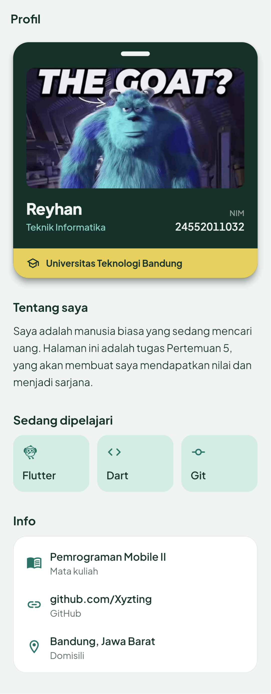

# Tugas Pertemuan 5: Mini Portfolio

Aplikasi Flutter satu halaman yang menampilkan profil mahasiswa dalam bentuk
kartu identitas. Mata kuliah Pemrograman Mobile II, Universitas Teknologi
Bandung.



## Ketentuan tugas

Semua kode ada di `lib/main.dart`.

| Ketentuan | Penerapan |
| --- | --- |
| Widget dasar: Text, Image, Icon | Nama dan bio (`Text`), foto profil (`Image.asset`), ikon keahlian dan info (`Icon`) |
| Widget layout: Row, Column | Nama dan NIM di kartu (`Row`), kotak keahlian (`Row`), susunan halaman (`Column`) |
| Container untuk styling | Kotak keahlian (padding, background), judul bagian (margin), pita kampus (background) |
| Card / ListTile | Kartu mahasiswa (`Card`), daftar info (`ListTile` di dalam `Card`) |
| ThemeData | `buatTema()`: warna utama, warna teks, tema AppBar, Card, dan ListTile |
| Font custom | Plus Jakarta Sans dari `assets/fonts/` (lisensi SIL OFL) |

## Menjalankan

```bash
flutter pub get
flutter run
```

## Test

```bash
flutter test
```

Test memeriksa bahwa widget yang diwajibkan terpakai, font custom terdaftar di
`pubspec.yaml`, foto profil ikut ter-bundle dan tampil utuh tanpa terpotong,
halaman tidak overflow di HP kecil dengan ukuran teks 200%, dan animasi kartu
mengikuti pengaturan "hapus animasi" di HP.
